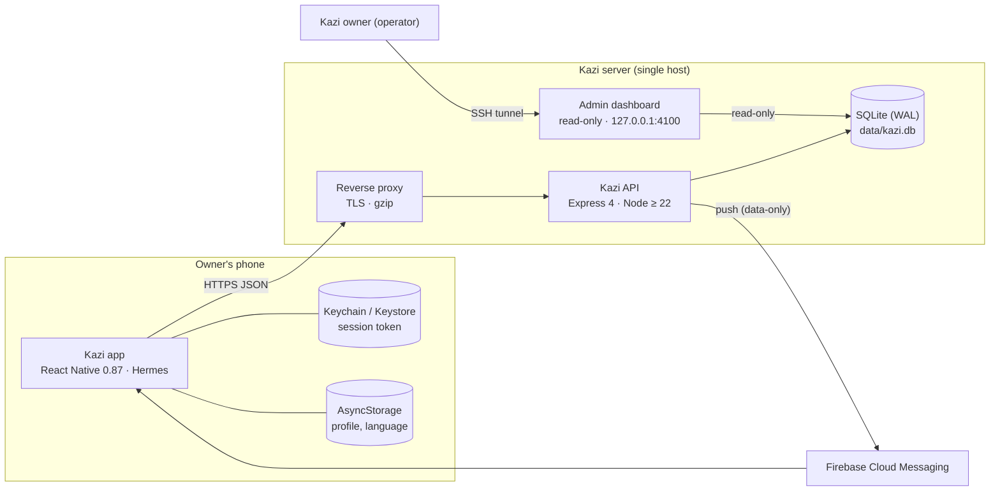
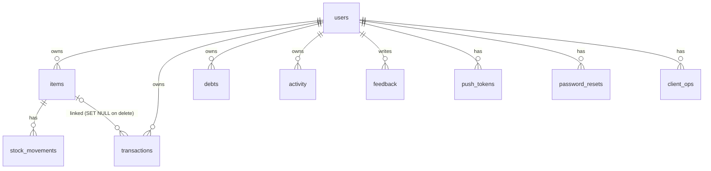
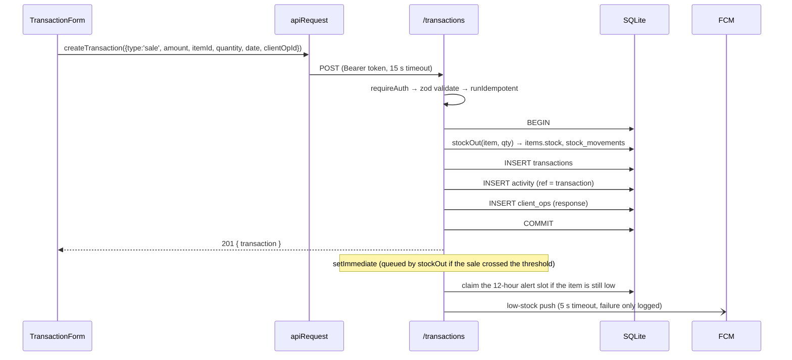
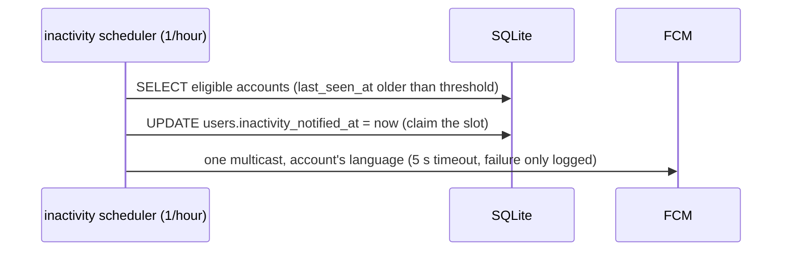

# Kazi — Design Architecture

How Kazi is built today, the rules every change must follow, and the target shape after the
tasks in [PROJECT_TRACKER.md](PROJECT_TRACKER.md) are done. Sections marked **Target** describe
planned changes and name the task that delivers them.

---

## 1. Product scope

Kazi is a trilingual (English / French / Cameroonian Pidgin) digital business notebook for small
businesses in Cameroon. An owner can:

- keep a catalog of products and services, with optional stock tracking and low-stock alerts;
- record sales (money in), expenses (money out) and capital (owner's own money put in);
- note debts (money owed to them) and mark them paid;
- see today's totals on Home and a day-by-day history with period totals.

Design priorities, in order: **correct money data → security → speed on low-end Android phones and
slow networks → simplicity**.

---

## 2. System context



The reverse proxy, TLS and SSH-tunnel access are the **target** deployment ([DEPLOYMENT.md](DEPLOYMENT.md)).
Today the API serves plain HTTP on port 4000.

---

## 3. Repository layout

```
kazi/
  App.tsx, index.js       App entry: language boot, providers, navigator, FCM background handler
  src/                    Mobile app (see §4)
  android/, ios/          Native projects (package com.kazi.app)
  __tests__/              Jest tests for the app
  shared/                 @kazi/shared: contracts both sides import (ADR A10)
    src/                  Pure TypeScript; tests run with node --test
    dist/                 Build output (ESM + .d.ts, git-ignored), what app and server load
  server/src/             API (see §5) and admin dashboard (server/src/admin)
  server/assets/          Files the API reads at start (common-password list, KZ-05)
    db/                   openDatabase(), migration runner (§6.1)
      migrations/         Numbered migrations NNNN_<name>.ts
  .github/workflows/      CI: ci.yml (app, server, audit; release jobs are manual placeholders)
  docs/                   This documentation set
```

**Shared contracts.** Anything the app and the API must agree on — limits, parsers, error codes,
types — lives once in `shared/src`. The package has no runtime dependencies and no Node or React
Native APIs (its `tsconfig.json` has no `types` and no DOM lib, so the compiler rejects them).
It is built with `tsc` and consumed through `file:` links: `"@kazi/shared": "file:./shared"`
(app) and `"file:../shared"` (server). Metro watches `shared/` and follows the symlink; Jest
transforms `shared/dist` with the app's Babel config; the server resolves it with NodeNext. Install
`shared/` first (its `prepare` script builds `dist/`) and rebuild it after editing.

---

## 4. Mobile app

### 4.1 Layers

```
screens/*            UI, form state, navigation           (no fetch calls)
   │
offline/api.ts       Facade the screens import            (pass-through today)
   │
<domain>/api.ts      items, transactions, debts, activity, summary, auth, feedback
   │
api/client.ts        apiRequest(): token, timeout, error mapping → ApiError / NetworkError
   │
fetch → HTTPS → API
```

Rules:

- Screens never call `fetch` directly; they go through the facade.
- All user-visible text goes through i18next (`src/i18n/locales/{en,fr,wes}.ts`); the parity test
  keeps the three locales in sync.
- Validation lives in `<domain>/validation.ts` and returns **translation keys**, never text.
- Forms show errors through `useFormErrors` (`src/forms/`, KZ-22): a field's error appears once the
  field is touched or after a Save attempt, and Save is disabled only while an error is visible.
- Request errors reach the user only through `errorMessage()` in `src/errors/messages.ts`
  (§5.4); `err.message` is never rendered (guarded by `__tests__/source.guards.test.js`).

### 4.2 App-wide state

| Provider | Holds | Notes |
|---|---|---|
| `AuthProvider` | `status`, `user`, auth actions | Token in Keychain (`WHEN_UNLOCKED_THIS_DEVICE_ONLY`), profile cached in AsyncStorage |
| `OfflineProvider` | `online` flag + offline pill | Event-driven via NetInfo (KZ-01): Android uses the OS's validated-internet signal; iOS checks `https://connectivitycheck.gstatic.com/generate_204` only while the app is active. No timer. Unknown reachability counts as online |
| `ToastProvider` | Transient messages | |

Screen data is loaded on focus (`useFocusEffect`) and kept in local component state. There is no
global data store.

### 4.3 Navigation

```
RootNavigator
├─ AuthFlow (stack): Welcome · Login · Signup · ForgotPassword · ResetPassword
└─ AppStack
   ├─ BusinessProfile             (shown until the user has a business)
   └─ MainTabs
      ├─ Home
      ├─ Products (stack): ProductsList · ProductForm
      ├─ History  (stack): HistoryList · TransactionForm · AddMoney · Debts · DebtForm
      └─ More     (stack): MoreHome · MyBusiness · Feedback · Support · Privacy · Terms · DeleteAccount
```

**Target (KZ-07):** add a transaction detail screen under History, reached by tapping a sale,
expense or capital row, with Delete (and later Edit).

### 4.4 Connectivity model

Kazi is **online-only**: reads hit the server and writes wait for the server's answer. Nothing is
queued on the phone. The backend keeps an idempotency ledger so that a retried write is safe
(see §5.5).

**Target (decision D7):** an optional read-only cache of the last Home, Products and History
results so screens render instantly and show "last updated" data when offline. Writes stay online.

---

## 5. API

### 5.1 Request pipeline

```
express()
 ├─ disable x-powered-by
 ├─ security headers (nosniff, DENY frames, no-referrer, Cache-Control: no-store)
 ├─ CORS (denied unless CORS_ORIGIN is set)
 ├─ express.json({ limit: '4mb' })        Target (KZ-14): lower once images move out of JSON
 ├─ /health
 ├─ /auth  /items  /transactions  /debts  /summary  /activity  /feedback  /notifications
 │     └─ router: requireAuth → validate(zod) → runIdempotent? → service (SQL) → JSON
 ├─ 404 handler
 └─ errorHandler → { error: { code, message } }
```

`trust proxy` comes from `TRUST_PROXY` (a hop count; KZ-08, `server/src/trustProxy.ts`), and each
authenticated router runs `requireAuth` then the per-user write limiter (`rateLimit.ts`) before
its routes.

**Target:** request timing and structured logs (KZ-34).

### 5.2 Module pattern

Each domain folder has the same three files:

| File | Responsibility |
|---|---|
| `routes.ts` | HTTP only: parse, call the service, pick the status code |
| `validation.ts` | zod schemas; numbers go through `strictNumber`, money through `moneyAmountSchema`, dates through `businessDateSchema` |
| `service.ts` | SQL and business rules; always scoped by `user_id`; multi-step writes in `db.transaction` |

### 5.3 Authentication and sessions

- Passwords: bcrypt (cost 10), hashed and compared with bcryptjs on a small worker-thread pool
  (`auth/passwordHash.ts`, ADR A14) so a login never blocks other requests; an unknown email is
  compared against a dummy hash made once at start (KZ-21). Weak passwords are refused by
  `auth/passwordPolicy.ts` with the shared rules in `shared/src/password.ts` and the list in
  `server/assets/common-passwords.txt` (KZ-05). `DELETE /auth/me` needs the password (KZ-20).
- Session: HS256 JWT, 30 days, carries `sub` and `ver` (`users.token_version`). `requireAuth`
  checks the version on every request, so a password reset invalidates old tokens.
- **Target (KZ-13, decision D4):** 15-minute access token + rotating refresh token stored hashed in
  a `sessions` table; logout and "log out everywhere" revoke server-side.
- Password reset (KZ-06, decision D2: email):
  - `POST /auth/forgot-password { email }` always answers `202` with one fixed body. The route
    checks only the per-email limit (3 codes per address per hour, counted for every address, in
    memory) and responds; the account lookup, the code and the email happen afterwards in
    `setImmediate`, so neither the body nor the timing says whether the account exists.
  - Code: 6 digits from `crypto.randomInt` (`auth/resetCode.ts`). `password_resets` stores
    `HMAC-SHA256(key, "<user id>:<code>")` with `key = HKDF-SHA256(JWT_SECRET, info
    "kazi-reset-code")`, plus `expires_at` (15 minutes), `attempts` and `used`. A new code
    deletes the account's older ones.
  - `POST /auth/reset-password { email, code, password }`: one query finds the newest usable code
    for that email (unused, unexpired, under 5 wrong tries); the HMAC is compared in constant time
    even when there is none. A mismatch adds a try (the fifth kills the code). Every failure is one
    `400 RESET_CODE_INVALID`, whether the email is unknown or the code is wrong, expired, used,
    replaced or dead. Only after the code matches is the password policy applied (it uses the
    account's names, so checking it earlier would leak them); then the code is claimed, the
    password changed, `token_version` bumped and the account's other codes deleted, in one
    transaction.
  - Delivery (`auth/delivery.ts`): `ResetCodeSender { send(to, code, language) }`, chosen once at
    boot by `resetDeliveryFromEnv`: `EmailSender` (templates in en/fr/wes in `resetEmail.ts`,
    sent through the HTTPS adapter in `emailTransport.ts` with a 5-second timeout: Brevo,
    Postmark or a generic `http` relay) when `EMAIL_PROVIDER` is set; `ConsoleSender` only when
    `NODE_ENV` is `development` or `test`; otherwise the server exits. A failed send is logged
    with the account id and a reason only.
  - Development shortcut: the code is also returned (`devCode`) only when the boot verdict allows
    it **and**, on each request, `ALLOW_DEV_RESET_CODE=1` and `NODE_ENV` is `development` or
    `test`. Boot fails if `ALLOW_DEV_RESET_CODE=1` with any other `NODE_ENV`.
  - App: Forgot Password asks only for the email and opens the code screen with
    `{ email, requestedAt }` (never the code). The code screen words `RESET_CODE_INVALID` from
    what it knows: "expired" once 15 minutes have passed since it asked, "used up" after 5 refused
    tries, "wrong" otherwise (`src/auth/resetFlow.ts`); "Send a new code" asks again. A debug
    build prefills a `devCode` through an in-memory hand-off, never route params.

### 5.4 Error contract

Every error is `{ "error": { "code": "<CODE>", "message": "<English text>", "field"?, "rule"? } }`
(type `ApiErrorBody` in `shared/src/errors.ts`).

- `code` is one of `API_ERROR_CODES` in `@kazi/shared`; `server/src/errors.ts` types `AppError`
  with it, so an unknown code does not compile. It is what the app uses.
- `message` is for logs and developers. The app never shows it.
- A `VALIDATION_ERROR` also carries `rule` (one of `VALIDATION_RULES`: `required`, `invalid`,
  `format`, `tooShort`, `tooLong`, `tooSmall`, `tooLarge`, `tooEarly`, `tooLate`, `notAllowed`)
  and, when the failure is about one request field, `field` (one of `VALIDATION_FIELDS`). Both come
  from the first zod issue (`issueDetail()`); a refinement names its rule with
  `params: { rule }`, and errors thrown by services pass `{ field, rule }` to `AppError`.
- App (KZ-12): `src/errors/messages.ts` is the only place that turns an error into text:
  `errors.codes.<CODE>`, or `errors.validation.<rule>` with the label `errors.fields.<field>`;
  `NetworkError` → `errors.offline`; `SERVER_UNREACHABLE` (app-side code) →
  `errors.serverUnreachable`; anything else → `errors.generic`. A screen may override a code's
  wording (Forgot Password words `TOO_MANY_REQUESTS` as too many codes asked for). Screens keep the error
  object in state and translate it while rendering, so a language switch re-translates it.
  Tests require a key for every code, rule and field in all three locales.

### 5.5 Idempotency

`client_ops(user_id, client_op_id, op_type, response)`. A write that carries a `clientOpId` is run
once; a repeat with the same id and type replays the stored response, a repeat with a different
type returns `409 IDEMPOTENCY_CONFLICT`. Applies to item create, stock in/out, transaction create,
debt create and debt pay.

Since KZ-11 the app sends one on every one of those writes. `newClientOpId()` (`@kazi/shared`)
makes a 25-character lowercase base36 id: 9 characters of the millisecond clock, 12 random, 4 of a
module counter. It is an idempotency key, not a secret: the ledger is keyed by `user_id`, so another
account can neither replay nor block it, and `Math.random` is enough. `useSubmission()`
(`src/forms/useSubmission.ts`) holds one id per submission: `opId(values)` on Save creates it,
reuses it while the values to send are unchanged (a retry after a timeout or lost answer), makes a
new one as soon as any value differs, and `succeeded()` drops it after the server confirmed. Forms:
TransactionForm, AddMoney, DebtForm, Debts (pay), ProductForm (create, stock in, stock out).

### 5.6 Activity log

Every money or catalog change writes an `activity` row in the same transaction, with
`ref_type`/`ref_id` pointing back at the source record. Deleting the source deletes its activity
rows, so History totals always agree with the source tables.

Since KZ-07 `GET /activity` returns `refType` (`transaction`, `debt`, `item`) and `refId` per event
(absent only on legacy rows), so History opens the source record: a transaction's detail sheet
(Delete, Correct), or the debt in the Debts list. Correct is save-new-then-delete-old, so a failed
save never loses the original.

### 5.7 Admin dashboard

A separate Express process (`server/src/admin`). Opens the database with `readonly: true` and
`query_only = ON`; its own credentials (scrypt), in-memory sessions, `HttpOnly; SameSite=Strict`
cookie, strict CSP, login throttling. App tokens mean nothing there. Binds to `127.0.0.1` by default.

---

## 6. Data model



| Table | Key columns | Notes |
|---|---|---|
| `users` | email (unique, lower-case), password_hash, token_version, company_name, business_type, language | |
| `items` | type (product/service), price (INTEGER FCFA ≥ 0), stock, track_stock, low_stock_threshold, last_low_stock_alert_at (epoch ms, KZ-03), image | **Target (KZ-14):** image moves to its own table |
| `stock_movements` | direction, quantity, new_quantity, reason | Audit trail of stock |
| `transactions` | type (sale/purchase/capital), amount (INTEGER FCFA > 0), item_id, quantity, date (YYYY-MM-DD) | |
| `debts` | name, amount (INTEGER FCFA > 0), date, status (open/paid), paid_at | |
| `activity` | type, title, amount (INTEGER FCFA or NULL), quantity, event_date, ref_type, ref_id | History feed |
| `client_ops` | (user_id, client_op_id) PK, op_type, response | Idempotency ledger |
| `password_resets` | token (SHA-256), expires_at, used | |
| `push_tokens` | token (unique), platform | |
| `feedback` | rating 1–5, liked, disliked, suggestion | |

### 6.1 Migrations

The schema changes only through numbered migrations in `server/src/db/migrations/`
(`NNNN_<name>.ts`, listed in order in `migrations/index.ts`). `openDatabase()` in
`server/src/db/index.ts` sets `journal_mode = WAL` and `foreign_keys = ON`, then
`runMigrations()` (`server/src/db/migrate.ts`) applies every migration newer than the highest
version in `schema_migrations(version INTEGER PRIMARY KEY, name TEXT, applied_at TEXT)`:

1. For each pending migration: `foreign_keys = OFF` (so tables can be rebuilt), then one
   transaction that runs `up(db)`, runs `PRAGMA foreign_key_check` (any violation throws and rolls
   the migration back), and records the version; then `foreign_keys = ON`.
2. A failure stops the server from starting; earlier migrations stay committed.
3. A database whose version is newer than the build logs a warning and is left alone (rollback to
   the previous release, see [DEPLOYMENT.md](DEPLOYMENT.md) §4).

`0001_baseline` is the schema as it stood when the framework was introduced (2026-10-10): the
original `CREATE … IF NOT EXISTS` statements (SQL text unchanged), every column added later with
`addColumnIfMissing`, the `activity.event_date` backfill and the rebuild that lets `transactions`
hold `'capital'`. Every step is idempotent, so the same migration creates a fresh database and
baselines a database created before `schema_migrations` existed, without data loss; both end with
an identical `sqlite_master` (tested). It also restores `idx_transactions_user_type_date`, which the
old rebuild dropped (KZ-26).

`0002_integer_money` (KZ-25) rebuilds `items`, `transactions`, `debts` and `activity` so every
money column is `INTEGER` with `CHECK (typeof(x) = 'integer' …)` (INTEGER affinity alone would
still store 12.5 as a REAL). Old values are rounded half away from zero; a positive amount below
0.5 becomes 1 so `amount > 0` still holds. It logs one warning with the number of rounded rows per
table, never the values.

`0003_language_wes` (KZ-24) is data-only: `users.language = 'pid'` becomes `'wes'`.

`0004_drop_password_fingerprints` (KZ-05) drops `password_fingerprints` and its index: the
"no two accounts may share a password" rule is gone (decision D1).

`0005_reset_codes` (KZ-06) recreates `password_resets` for emailed codes: `id` (primary key),
`user_id` (→ `users`, `ON DELETE CASCADE`), `code_hash` (`CHECK length = 64`), `expires_at`,
`attempts` (`CHECK >= 0`), `used` (`CHECK IN (0, 1)`), `created_at`, and
`idx_password_resets_user(user_id)`. The old table was keyed by the hash of a long token; a
6-digit code can repeat across accounts, so it can't be the key. Old rows (30-minute tokens for a
flow that no longer exists) are dropped, not converted.

`0006_low_stock_alert` (KZ-03) adds `items.last_low_stock_alert_at INTEGER` (epoch ms, NULL =
never): when the API last sent a low-stock push for the item, for the once-per-12-hours rule.

`0007_announcements` (merged from main, 2026-10-15) creates `announcements` (one slot, id 1: `body_en`, `body_fr`, `body_pid` — the Pidgin text, language code `wes` — `min_version`, `max_version`, `active`). main created it in the old pre-framework boot code, so the migration keeps `IF NOT EXISTS` and main's exact statement text: a database made by that code is baselined and ends with the same schema as a fresh one (`0007_announcements.test.ts`).

`0008_push_notifications` (KZ-03) adds `users.push_notifications` (`INTEGER NOT NULL DEFAULT 1`): the master push switch the Notifications screen toggles.

`0009_inactivity_notifications` (KZ-04, decision D9) adds three columns to `users`, all epoch ms or a flag, all additive (no table rebuild): `last_seen_at INTEGER` (NULL = never seen; written by the throttled presence hook, decision in §8.3), `inactivity_notifications INTEGER NOT NULL DEFAULT 0` (the separate opt-in switch; conservative default off, so nobody is nudged until they ask), and `inactivity_notified_at INTEGER` (NULL = never nudged; the once-per-repeat-window slot, claimed before the send like `items.last_low_stock_alert_at`).

Rules for new migrations:

- Never edit a migration that has shipped; add a new file with the next number.
- SQLite can't change a column type or CHECK in place: rename the old table aside, create the new
  one under its real name (so `sqlite_master` keeps an unquoted name), copy, drop the old one, then
  recreate **every** index; preserve `sqlite_sequence` when ids must not be reused. If other tables
  reference the rebuilt one, do the rename with `PRAGMA legacy_alter_table = ON`, or SQLite
  rewrites their `REFERENCES` to the copy that is about to be dropped. `rebuild()` in
  `0002_integer_money.ts` does all of this.
- Test each migration on a fresh database and on a database with the previous schema and data
  (`server/src/db/migrations.test.ts`; `legacyFixtures.ts` holds the frozen pre-framework code).

---

## 7. Cross-cutting rules

### 7.1 Business dates and time zones

- A business date is a calendar day in the **owner's** time zone, always `YYYY-MM-DD`, chosen on
  the phone. It is never derived from a server timestamp.
- Any endpoint that answers "today", "yesterday" or "this week" takes `asOf` from the phone.
  `/activity` and `/summary` do (KZ-10: Home's "today" is the phone's day, so Home and History
  agree just after midnight even on a UTC server). Without `asOf` the server's local day is the
  fallback.
- Instants (`created_at`, `paid_at`) are UTC.
- The accepted window is `BUSINESS_DATE_MIN` (2000-01-01) to today + 365 days (`@kazi/shared`
  `date.ts`); the API, the app's validators and the date picker all use it (KZ-16).

### 7.2 Money

- Currency is FCFA (XAF), which has no minor unit.
- **Input (KZ-04, done):** every money field (sale, expense, capital, debt, product price) reads
  text with `parseMoneyInput` from `@kazi/shared`: spaces ignored, `,` or `.` only as thousands
  separators in groups of three, anything else rejected. The parsed value is shown under the field
  as the user types (`= 1 000 FCFA`). The API accepts only a JSON integer or a digit string
  (`moneyAmountSchema`, `priceSchema`), at most `MONEY_MAX`.
- **Storage (KZ-25, done):** `INTEGER` money columns with integer CHECKs (§6.1, migration 0002).
- **Display (KZ-25, done):** one formatter, `formatMoney` from `@kazi/shared`: `1 000 FCFA` with
  the narrow no-break space (U+202F) between groups and before `FCFA`, so an amount never wraps.
  The app uses it for every amount and price; the admin dashboard loads the same built module from
  `/shared/index.js` (served from `node_modules/@kazi/shared/dist`).

### 7.3 Internationalisation

- Languages: `en`, `fr`, `wes` (`APP_LANGUAGES` in `shared/src/language.ts`). **Decision
  (KZ-24, ADR A13):** Cameroonian Pidgin is `wes`, its ISO 639-3 code. The old `pid` is Piaroa;
  a private-use tag (`x-pidgin-cm`) or `en-CM` was considered and rejected because a registered
  code exists and `en-CM` means Cameroonian English. A stored `pid` choice becomes `wes` on load,
  and migration `0003_language_wes` rewrites `users.language`.
- The language code picks the translations; dates and numbers use a separate **formatting
  locale** (`formattingLocale()` in `src/i18n`): `en` → `en-CM`, `fr` → `fr-CM`, `wes` → `en-CM`
  (Intl has no Pidgin data). The date picker and History's day headings use it.
- The choice follows the account: switching language saves it on the phone first, then
  `PATCH /auth/me/language` (`en|fr|wes`, the caller's own row) best effort, never blocking the
  switch. A new account is saved with the language on screen. After login, or at start with a
  session, a phone with no saved choice (for example after a reinstall) takes the server's value.
- No user-facing English text may come from the server: errors are translated by code (KZ-12,
  §5.4).

### 7.4 Validation parity

The API is the authority; the app mirrors its limits so users see errors before submitting.
Since KZ-16 there is one copy: `shared/src/limits.ts` (lengths, quantity and threshold max,
password 8 characters min / 72 UTF-8 bytes max, page sizes, client-op-id length), `MONEY_MAX` and
the business-date window. Server zod schemas and app validators both import it, and the app's
`maxLength` props name the same constants. Each side boundary-tests every limit, so a validator
that stops using the shared constant fails a test.

---

## 8. Key flows

### 8.1 Record a sale of a tracked product



**Low-stock alert (KZ-03, decision D6).** `stockOut` (sales, manual stock-outs and purchase
reversals all go through it) checks whether the change takes a tracked item with a threshold
above 0 from above its threshold to at or below it. If so it queues a job with `setImmediate`:
better-sqlite3 is synchronous, so the job runs only after the request's outermost transaction
has committed or rolled back, and never delays the response. The job (`notifications/lowStock.ts`)
skips users without devices and servers without Firebase credentials, then in one `UPDATE`
re-checks that the item is still low and that no alert went out in the last 12 hours
(`last_low_stock_alert_at`), and only then sends one multicast to the owner's devices in the
account's language (`users.language`). A rolled-back write leaves the stock above the threshold,
so nothing is sent. FCM errors and the 5-second timeout are logged with the user id and an error
code only; dead tokens are deleted as for any send.

Failure rules: the slot is claimed before the send, so a crash or restart mid-send can't produce a
second alert. If FCM refuses the request, or answers but no device accepted the message, the job
releases its own claim (`last_low_stock_alert_at` back to NULL only if it still holds the job's
timestamp), so the next crossing alerts again. After a timeout the claim is kept, because FCM may
still deliver late and a duplicate is worse than a miss. On SIGTERM/SIGINT (`server/src/shutdown.ts`)
the API stops accepting connections, lets in-flight requests finish, waits for queued alerts
(`settleLowStockAlerts`), closes the database and exits 0; a second signal or 15 s exits 1. A
`kill -9` or power loss can still drop an alert that was queued but not yet claimed. That's
accepted for a convenience alert: Home's low-stock count stays correct either way. `stock` is
written only by `stockIn` and `stockOut`, and a source-guard test enforces it so a new path can't
skip the alert.

If the response is lost and the user taps Save again, the same `clientOpId` replays the stored
response: no second sale, no second stock movement (KZ-11).

### 8.2 App start

1. Load stored language → initialise i18next.
2. Read token from Keychain. None → AuthFlow.
3. `GET /auth/me`. 200 → AppStack. 401 → clear token → AuthFlow. Network error → use cached
   profile. **Target (KZ-17):** if there is no cached profile, show a retry screen instead of
   AppStack with no user.
4. Authenticated → request notification permission → register FCM token.

### 8.3 Inactivity re-engagement push



**Activity breadcrumb (KZ-04).** `requireAuth` (`server/src/middleware/auth.ts`), after a request
authenticates, records `users.last_seen_at = now` at most once per hour
(`LAST_SEEN_THROTTLE_MS`, `notifications/presence.ts`). The write is **best-effort**: it is wrapped
in a `try/catch` and never fails or delays the request it rode in on; a database error while
stamping presence is swallowed. `last_seen_at` is NULL for everyone until their first
authenticated request after this ships, and NULL is never treated as "inactive".

**The scheduler (KZ-04, decision D9).** `startInactivityScheduler`
(`server/src/notifications/inactivity.ts`) is started by `src/index.ts` **only when Firebase is
configured** (`FIREBASE_SERVICE_ACCOUNT` or `GOOGLE_APPLICATION_CREDENTIALS`); without credentials
every send is skipped, so nothing is scheduled. It runs on one `setInterval`
(`INACTIVITY_SCAN_INTERVAL_MS`, 1 hour), `unref`'d so it never keeps the process alive, with a
`running`/`inFlight` guard so two ticks can't overlap in the process. This is safe because the
production topology is a single API process (§10). SIGTERM/SIGINT stops the scheduler first
(`inactivity?.stop()` in the `shutdown.ts` `settle` step) before the low-stock queue is drained.

**Eligibility and the two switches.** A scan (`findCandidates`, all in SQL) selects accounts whose
`last_seen_at` exists and is older than `INACTIVITY_THRESHOLD_MS` (7 days), oldest activity first,
capped at `INACTIVITY_BATCH_SIZE` (500) per tick. A send then requires **both** the account-level
master switch (`users.push_notifications`) and the separate opt-in
(`users.inactivity_notifications`, default **off**) — `inactivityNotificationsAllowed` in
`preferences.ts`. An account with no devices is skipped without spending the slot. The nudge is one
data-only multicast in the account's language (`inactivityMessage.ts`, en/fr/wes; `type: inactivity`
data), and it repeats at most once per `INACTIVITY_REPEAT_MS` (7 days).

**Failure rules (mirrors the low-stock alert).** The slot `users.inactivity_notified_at` is claimed
in one `UPDATE` before the send, so a crash or restart mid-send can't double up. If FCM refuses, or
answers with no device accepted (`NoDeviceAcceptedError`), the claim is released (only if it still
holds the job's timestamp) so the next scan retries; after a timeout the claim is kept (a duplicate
is worse than a miss). Dead tokens are deleted as for any send, invalid-token cleanup is unchanged,
and a per-account error is logged with the user id and an error code only — never a token or email —
without stopping the scan. History is recorded only for sends at least one device accepted
(`notifications/service.ts`, unchanged).

**The tap.** `type: inactivity` maps in the app's `pushNavigation.ts` to Home
(`{ name: 'Main', params: { screen: 'Home' } }`).

---

## 9. Architecture decisions

| ADR | Decision | Status | Why |
|---|---|---|---|
| A1 | Online-only app, server is the source of truth | Accepted | The offline-first attempt was abandoned (see `OFFLINE_FIRST_VERIFICATION.md`); a single source avoids sync conflicts on money data |
| A2 | SQLite (WAL) on one server | Accepted | Very low ops cost; plenty for the expected scale. Revisit at roughly 50 writes/s sustained or when a second API instance is needed |
| A3 | Idempotency ledger for writes | Accepted | Makes retries on flaky mobile networks safe |
| A4 | Activity log written in the same transaction as the source record | Accepted | History can never disagree with the source tables |
| A5 | Separate read-only admin process | Accepted | App users can never reach admin data; admin cannot write. Exception pending decision D8: with `ADMIN_ANNOUNCEMENTS=1` it opens a second, writable handle used only for the announcement slot (off by default) |
| A6 | Whole-number FCFA everywhere | Accepted (2026-10-11, KZ-04, KZ-25) | Removes the decimal-separator ambiguity that corrupts amounts |
| A7 | Short-lived access token + refresh token | Proposed (KZ-13, D4) | Real logout and revocation |
| A8 | Images stored and served separately from item JSON | Proposed (KZ-14) | Keeps list payloads small on 3G |
| A9 | Error codes, not messages, drive the UI | Accepted (2026-10-11, KZ-12) | Correct language for every user; codes, rules and fields live in `@kazi/shared` (§5.4) |
| A10 | One shared contracts package (`@kazi/shared`, built with tsc, `file:` links) | Accepted (2026-10-10, session 1) | App and API can't drift on limits, parsers and codes. Metro 0.87 (symlinks + `exports` on by default), Jest and NodeNext all resolved the link without workarounds, so the path-mapped-source fallback wasn't needed |
| A11 | Numbered migrations recorded in `schema_migrations`, one transaction each, `foreign_key_check` before commit | Accepted (2026-10-10, session 1) | Each schema change runs exactly once, in order, all-or-nothing; pre-framework databases are baselined in place (§6.1) |
| A13 | Pidgin is `wes` (ISO 639-3); dates use a formatting locale separate from the language code | Accepted (2026-10-11, KZ-24) | `pid` is Piaroa; a registered code beats a private-use tag; Intl has no `wes` data, so formatting uses `en-CM` (§7.3). A12 is reserved for the read cache (session 13) |
| A14 | Password hashing runs bcryptjs on a worker-thread pool (CPUs − 1, between 1 and 4), started with the server | Accepted (2026-10-14, KZ-21) | bcryptjs async only yields every 100 ms and a cost-10 hash fits in one slice, so async alone still froze the event loop for each login (measured: 20 parallel compares blocked it for 2.35 s). Workers keep the pure-JS library (no native build, same `$2a$`/`$2b$` hashes); the native `bcrypt` package was the alternative |
| A15 | Password reset by an emailed 6-digit code: stored as an HMAC, a uniform 202 with the work done after the response, one error for every failure, and a sender chosen at boot that fails closed | Accepted (2026-10-14, KZ-06) | The old flow returned the code in the response outside production and could not deliver in production. An HMAC keyed from `JWT_SECRET` keeps a leaked database from revealing live codes (a plain hash of 6 digits is reversed instantly). While the email provider (D2) is pending, a small HTTPS adapter supports Brevo, Postmark and a generic relay, so choosing one is configuration, not code |
| A16 | An inactivity re-engagement push, decided per account, sent by one in-process scheduler guarded by a database-backed slot | Accepted (2026-10-16, KZ-04, decision D9) | A shop owner who stops opening the app loses the value of reminders. It is a second automated remote sender after the low-stock alert, so it reuses that machinery: a nullable `users.last_seen_at`, an opt-in switch that defaults off, and the same claim-before-send slot. The single-API-process topology (§10) makes an in-process interval safe; the slot claim makes overlapping ticks — or a future second instance — unable to double-send |

Add a row for every new architectural decision, and update the status when it changes.

---

## 10. Scaling path (for later, not needed for launch)

1. Vertical: bigger host, SQLite stays (handles thousands of shops comfortably).
2. Move rate limiting and admin sessions to a shared store before running more than one API process.
3. Move to PostgreSQL only when write concurrency or multi-region needs require it. Services already
   isolate SQL per domain, which keeps that move contained.
